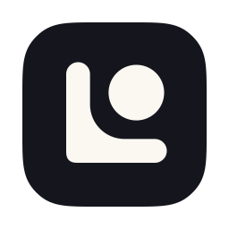

# Lo brand

<picture>
  <source media="(prefers-color-scheme: light)" srcset="logo/lockup-ink.svg">
  
</picture>

The mark, the wordmark, the app icon, the few colors and type settings around them, how the mark moves, and the app's color theme. There are no components here on purpose.

Paths in this file are relative to this folder, `brand/`. From the repository's root, they start with `brand/`: `logo/mark.svg` is `brand/logo/mark.svg`.

## The name

Write it **Lo**, always with a capital L, wherever people read it. A lowercase l looks like a capital I in most sans-serif fonts, so "lo" reads as "Io".

Lowercase `lo` appears only as code, such as the terminal command, the Homebrew name, the repo and `lo://` links. "The name" in [`CLAUDE.md`](../CLAUDE.md#the-name) has the full list.

## The mark

An L holding a ball that is lifted out of its socket. It is one shape in one color.

| File | Use |
| --- | --- |
| [`logo/mark.svg`](logo/mark.svg) | Takes the surrounding text color (`currentColor`) |
| [`logo/mark-chalk.svg`](logo/mark-chalk.svg) | On dark backgrounds (the default) |
| [`logo/mark-ink.svg`](logo/mark-ink.svg) | On light backgrounds |
| [`logo/mark-black.svg`](logo/mark-black.svg) | The menu bar, set as a template image so macOS tints it |
| [`logo/png/mark-*.png`](logo/png/) | 512 px exports, for places that won't take SVG |

**Clear space.** Keep the ball's radius free on every side: 21 units of the mark's 76, a little over a quarter of its height. The PNG exports have no margin, so add it where you place them.

**Minimum size.** 16 px for the mark, and 20 px tall for the lockup. No separate small version is needed.

**Don't:** seat the ball in the socket, color the ball, outline the mark, rotate or flip it, change its proportions, stretch it, or add shadows, glows or gradients. Keep it on ink or chalk, or on whatever background it reads clearly against.

## Wordmark and lockup

The wordmark is the name set in Host Grotesk ExtraBold, tracked in by 2%, and converted to shapes so it needs no font installed. The lockup puts the mark and wordmark side by side. The gap between them is one ball radius, and the wordmark's cap height is two thirds of the mark's height.

| File | Use |
| --- | --- |
| [`logo/lockup.svg`](logo/lockup.svg), [`logo/wordmark.svg`](logo/wordmark.svg) | Take the surrounding text color (`currentColor`) |
| [`logo/lockup-chalk.svg`](logo/lockup-chalk.svg), [`logo/wordmark-chalk.svg`](logo/wordmark-chalk.svg) | On dark backgrounds (the default) |
| [`logo/lockup-ink.svg`](logo/lockup-ink.svg), [`logo/wordmark-ink.svg`](logo/wordmark-ink.svg) | On light backgrounds |
| [`logo/social-preview.svg`](logo/social-preview.svg), [`logo/png/social-preview.png`](logo/png/social-preview.png) | The repo's social preview: the chalk lockup on ink, 1280 × 640 |

## The README banner

[`banner/banner-dark.svg`](banner/banner-dark.svg) (chalk on ink) and [`banner/banner-light.svg`](banner/banner-light.svg) (ink on chalk) head the repository's [`README.md`](../README.md). Each is 1600 × 480, with the lockup at three times its size in the middle and thin corner ticks in the secondary text color, at half opacity.

They're animated SVGs, which GitHub plays in a README. The banner is the hand-off lockup intro (see "Motion"), taken from [`motion/lockup-handoff-chalk.svg`](motion/lockup-handoff-chalk.svg) and [`motion/lockup-handoff-ink.svg`](motion/lockup-handoff-ink.svg). It plays once and holds on the finished lockup: each animation uses `fill="freeze"` in place of `repeatCount="indefinite"`, and the preview's fade-out is gone. With reduced motion turned on, it shows the static lockup instead. Change both files together, and rebuild them the same way when the hand-off changes.

The banner follows the reader's theme, and shows the dark one where the theme isn't known. From the repository's root:

```html
<picture>
  <source media="(prefers-color-scheme: light)" srcset="brand/banner/banner-light.svg">
  
</picture>
```

## The app icon



The chalk mark on an ink rounded square, flat like the mark: no gradient, shadow or glow. It's drawn on macOS's app icon grid, a 1024 px canvas with an 824 px rounded square and 100 px around it. The square's corners are the shape macOS 26 and later draw, fitted to Icon Composer's own mask.

The mark is 450 px wide: centered, it and its clear space would fill the largest square that fits inside the rounded square. It sits 9 px up and to the right of center instead, half way to its center of mass, so the L's heavier corner doesn't drag it down, and it still keeps more than its clear space from the square's edge. At 16, 32 and 64 px, the mark moves by half a pixel at most so the L's outer edges land on whole pixels and stay sharp. It's the same design at every size.

| File | Use |
| --- | --- |
| [`icon/app-icon.svg`](icon/app-icon.svg) | The source; change the icon here |
| [`Lo.icns`](Lo.icns), [`Lo.iconset/`](Lo.iconset/) | The app's icon (`CFBundleIconFile`), 16 to 512 pt at @1x and @2x |
| [`icon/Lo.icon/`](icon/Lo.icon/) | The same icon as an Icon Composer file, for macOS 26 and later (below) |
| [`icon/sizes.png`](icon/sizes.png) | The small sizes on light and dark grounds, to check them by eye |

After changing `icon/app-icon.svg`, rebuild the rest on a Mac and commit them together:

```sh
brand/icon/build.sh
```

**macOS 26 and later** redraw app icons in their own glass style. On macOS 27, from a plain `Lo.icns`, macOS lifts the mark off the square and shades it with a gradient, an edge highlight and a shadow, which the mark's rules don't allow. An icon that doesn't fill the square, such as a mark on transparent, goes in a gray square instead. [`icon/Lo.icon`](icon/Lo.icon/) turns those effects off (`icon.json`), so the mark stays flat, and keeps the square ink in dark mode; macOS still adds a thin edge to the square. Its layer, `icon/Lo.icon/Assets/mark.svg`, is made by `build.sh`. `script/bundle-mac` compiles it with `actool` (Xcode 26 and later) into the app's `Contents/Resources/Assets.car`, which `Info.plist`'s `CFBundleIconName` names, and copies `Lo.icns` beside it for older macOS, which reads `CFBundleIconFile`; `script/check-bundle` fails an app without both.

## Where each asset goes

| Place | Use |
| --- | --- |
| README header | The banner, `banner/banner-dark.svg` on dark and `banner/banner-light.svg` on light (snippet in "The README banner") |
| Other Markdown headers, such as this file's | `logo/lockup-chalk.svg` on dark, `logo/lockup-ink.svg` on light (snippet below) |
| getlo.dev header (planned) | Lockup, with the hand-off as the hero (see "Motion") |
| Repo social preview | `logo/png/social-preview.png`, exported from `logo/social-preview.svg`; upload it in the repo's settings |
| App icon | `icon/Lo.icon`, compiled into the app's `Assets.car` for macOS 26 and later, and `Lo.icns` for older macOS (see "The app icon") |
| GitHub sign-in | The mark alone, chalk on ink: `logo/png/mark-chalk-512.png` with the badge background set to `#15161D`; GitHub shows the name beside it |
| Menu bar | `logo/mark-black.svg` as a template image (see "To come") |
| Window titles | The name as text, no mark |
| The app's color theme | `themes/lo-glow.json`, with Lo Glow Dark and Lo Glow Light (see "App theme") |

Where the reader's theme isn't known, use the dark version: chalk on ink. A Markdown header that follows the reader's theme, and falls back to dark, from the repository's root (this file uses the same paths without `brand/`):

```html
<picture>
  <source media="(prefers-color-scheme: light)" srcset="brand/logo/lockup-ink.svg">
  
</picture>
```

## Color

Ink and chalk are fixed. The accent is for the interface only: links, focus rings, selection and the main button. It never goes in the mark.

| | Dark (default) | Light |
| --- | --- | --- |
| Ground | `#15161D` ink | `#FBF8F2` chalk |
| Text and mark | `#FBF8F2` chalk | `#15161D` ink |
| Secondary text | `#A7A398` stone | `#66625A` umber |
| Rules and borders | `#33353D` | `#E1DED8` |
| Accent | `#A5C5E9` powder | `#0664B2` deep powder |
| Text on accent | `#15161D` | `#FBF8F2` |

Every pairing of text and background meets WCAG AA contrast. Keep green, red and purple for diffs and pull request status, as GitHub uses them.

The same values are in [`tokens/brand.css`](tokens/brand.css) (CSS custom properties, dark by default, light through `prefers-color-scheme` or `data-theme="light"`) and [`tokens/brand.json`](tokens/brand.json).

## Type

- **Host Grotesk** for text, at weights 400 to 800.
- **Fragment Mono** for code.

This is the same pairing as scornz, so the two brands feel related. Both fonts are free under the SIL Open Font License, from Google Fonts ([Host Grotesk](https://fonts.google.com/specimen/Host+Grotesk), [Fragment Mono](https://fonts.google.com/specimen/Fragment+Mono)). Use them for the README, getlo.dev (planned) and the sign-in screen. GitHub sets a README's text in its own fonts, so there the banner's wordmark carries the type. Inside the app, the system font keeps Lo feeling native.

| Style | Size / line height | Weight |
| --- | --- | --- |
| Display | 48 / 1.05 | 800 |
| Title | 28 / 1.2 | 700 |
| Body | 17 / 1.5 | 400 |
| Small | 14 / 1.4 | 400 |
| Code | 14 / 1.5, mono | 400 |

## Motion

The mark moves by melding. At rest, the L and the o are one rounded triangle. When the o leaves, it takes its mass with it: the corner drains like a pool, a liquid neck stretches and snaps, and the ball overshoots a little and settles in the socket. Played backwards, the ball melds back in.

| Animation | Use | Settles after | Preview |
| --- | --- | --- | --- |
| Unmeld | App launch | 1.4 s | [`motion/unmeld-chalk.svg`](motion/unmeld-chalk.svg), [`-ink`](motion/unmeld-ink.svg) |
| Meld loop | Loading; repeats while the wait lasts | 2.8 s per loop | [`motion/meld-loop-chalk.svg`](motion/meld-loop-chalk.svg), [`-ink`](motion/meld-loop-ink.svg) |
| Kiss | Approved, or another small confirmation | 1.2 s | [`motion/kiss-chalk.svg`](motion/kiss-chalk.svg), [`-ink`](motion/kiss-ink.svg) |
| Unmeld, then the name | Lockup intro, the quiet one | 1.4 s | [`motion/lockup-unmeld-chalk.svg`](motion/lockup-unmeld-chalk.svg), [`-ink`](motion/lockup-unmeld-ink.svg) |
| Echo | Lockup intro; the name repeats the move | 2.4 s | [`motion/lockup-echo-chalk.svg`](motion/lockup-echo-chalk.svg), [`-ink`](motion/lockup-echo-ink.svg) |
| Hand-off | Splash screen and the getlo.dev hero | 3.3 s | [`motion/lockup-handoff-chalk.svg`](motion/lockup-handoff-chalk.svg), [`-ink`](motion/lockup-handoff-ink.svg) |

Each preview comes in chalk (for dark backgrounds) and ink (for light ones). They are animated SVGs that loop, so you can open them in a browser or put them in a README. They fade in and out only so that they loop; in the app, leave the fades out.

**Rules**
- One color, the same as the static mark. The accent stays out of motion too.
- Each animation plays once and ends on the static mark or lockup. The meld loop is the only one that repeats.
- When Reduce Motion is on, show the static mark or lockup and skip the animation.

**Rebuilding it natively.** [`motion/motion.json`](motion/motion.json) has everything needed to rebuild these in the app: the geometry of the triangle and the socket, every keyframe for the pool, ball and neck, and the easing curves. The liquid look comes from blurring the shapes together and then cutting the blur off at a hard alpha threshold, with crisp copies of the shapes drawn on top. In SwiftUI, a `Canvas` with a blur filter followed by an alpha-threshold filter does this; a small Metal shader also works.

Easing curves, also in [`tokens/brand.css`](tokens/brand.css) and [`tokens/brand.json`](tokens/brand.json):

| Name | Cubic bezier | Where |
| --- | --- | --- |
| In-out | `0.45, 0, 0.55, 1` | Swelling, settling |
| In | `0.6, 0, 0.9, 0.5` | The pull before the snap |
| Out | `0.2, 0.7, 0.3, 1` | The snap, the landing, the overshoot |

## App theme

[`themes/lo-glow.json`](themes/lo-glow.json) is the default theme for the app, as a Zed theme file with two themes in it: **Lo Glow Dark** and **Lo Glow Light**. It covers the whole interface, not just the code: panels, tabs, buttons, focus rings, search matches, selection, status colors, the terminal and syntax highlighting.

- **Chrome.** Panels, tab bars, the title bar and the status bar use a step lighter than the ground (`#1B1C23` on dark, `#F4F1E9` on light). The code area and the active tab sit on the ground itself, ink or chalk.
- **Accent.** Powder is the only accent: focus rings, the cursor, selection, links and the main button. `#A5C5E9` on dark, `#0664B2` on light.
- **Syntax.** Glow: pink keywords and operators, green functions, yellow strings, aqua types, violet constants, orange parameters. Parameters and comments are italic.
- **Diffs.** Whole added and removed lines use `created.background` and `deleted.background`. Changed words within them use `version_control.word_added` and `version_control.word_deleted`. The `+` and `−` markers and the gutter use `created` and `deleted`.
- **Status.** Errors red, warnings and modified files amber, success green, info Powder.

Every syntax color reaches at least 4.5:1 contrast on plain, added and removed lines, changed words included. Text, muted text, placeholders and status colors reach 4.5:1 on the surfaces they sit on. None of the syntax colors is taken from Monokai or Monokai Pro.

If a part of Lo draws something the theme has no key for, use these:

| Thing | Dark | Light |
| --- | --- | --- |
| Diff hunk header (`@@ … @@`) | background `#191F27`, text `#9598A5` | background `#E3ECF7`, text `#706961` |
| File header above a diff | `editor.subheader.background` | `editor.subheader.background` |
| Text on the main button | `#15161D` | `#FBF8F2` |

## To come

Made later, here in `brand/`, from the mark and these rules:

- **The menu-bar icon.** The mark as a template image, black on transparent, at @1x and @2x, so macOS tints it for light and dark menu bars.
- **The DMG background.** The window behind the app and the Applications folder when the disk image opens, at @1x and @2x. Finder shows it whatever the reader's theme, so it's the dark version.
