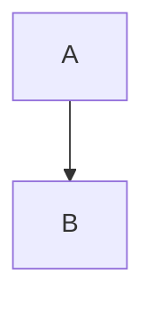

# Every construct

A paragraph with **strong**, *emphasis*, ~~strike~~, ~single strike~, `code`, a [link](https://example.com "with a title"), a [relative link](../blob/main/README.md), an [anchor link](#tables), and a line
break here.\
And a hard break.

## Mentions and references

@rozed-bot, @rozed-dev/maintainers, @rozed-dev, and someone@example.com.

#23, rozed-dev/e2e#17, GH-23, https://github.com/rozed-dev/e2e/pull/23, https://github.com/rozed-dev/e2e/issues/1, and the commit 9f10e83.

Autolinks: www.example.com, https://example.com/path?q=1, and <https://example.com/angle>.

## Alerts

> [!NOTE]
> A note.

> [!TIP]
> A tip, with **strong** text.

> [!IMPORTANT]
> Important.

> [!WARNING]
> A warning.

> [!CAUTION]
> Caution, over
> two lines.

> [!NOTE]

> A plain quote.
>
> > Nested.

## Task lists

- [ ] Open
- [x] Done
  - [ ] Nested open
- Plain item

1. [x] Numbered task
2. Second

## Code

```ts
const answer: number = 42;
```

```diff
- old
+ new
```

```
no language
```

    indented

```suggestion
suggested line
```



```math
x^2 + y^2 = z^2
```

Inline math $x^2$ and display math:

$$
\sum_{i=1}^n i
$$

## Footnotes

Text with a footnote[^1] and another[^note], and the first again[^1].

[^1]: The first footnote.
[^note]: A named footnote, with `code` and a [link](https://example.com).

    And a second paragraph.

## Details

<details>
<summary>Folded <b>summary</b></summary>

Markdown **inside** the fold.

</details>

<details open>
<summary>Open fold</summary>

Shown.

</details>

## Images and media


<picture>
  <source media="(prefers-color-scheme: dark)" srcset="https://www.w3.org/assets/logos/w3c/w3c-no-bars.svg">
  
</picture>

[](https://www.w3.org/)

<video src="https://example.com/movie.mp4" poster="https://example.com/poster.png"></video>

https://github.com/user-attachments/assets/00000000-0000-0000-0000-000000000000


## Emoji

:+1: :tada: :octocat: and a literal 🎉.

## Tables

| Left | Center | Right | None |
|:-----|:------:|------:|------|
| a | **b** | `c` | [d](https://example.com) |
| e | f | | h |

## Raw HTML

<p align="center">A centered paragraph with <kbd>Ctrl</kbd>+<kbd>C</kbd>, H<sub>2</sub>O and x<sup>2</sup>.</p>

<div id="custom" class="evil" style="color:red" data-x="1" onclick="alert(1)">A div with attributes.</div>

<a name="named-anchor"></a><a id="id-anchor" href="#tables">An HTML anchor link</a>

<script>alert(1)</script><style>p{color:red}</style><iframe src="https://example.com"></iframe>

<ins>Inserted</ins>, <del>deleted</del>, <s>struck</s>, <mark>marked</mark>, <q>quoted</q>, <abbr title="HyperText">HTML</abbr>, <samp>sample</samp>, <var>x</var>, <tt>tt</tt>, <small>small</small>, <big>big</big>, <u>u</u>, <cite>cite</cite>, <dfn>dfn</dfn>, <ruby>漢<rt>kan</rt></ruby>, <bdo dir="rtl">bdo</bdo>.

<dl><dt>Term</dt><dd>Definition</dd></dl>

<table><thead><tr><th>HTML</th></tr></thead><tbody><tr><td>table</td></tr></tbody></table>

<h3>An HTML heading</h3>

<!-- An HTML comment -->

Line one<br>Line two

<hr>

## Headings

### A heading with `code` and *emphasis*

### A heading with `code` and *emphasis*

#### Ünïcode & punctuation!?

##### Five

###### Six

---

The end.
